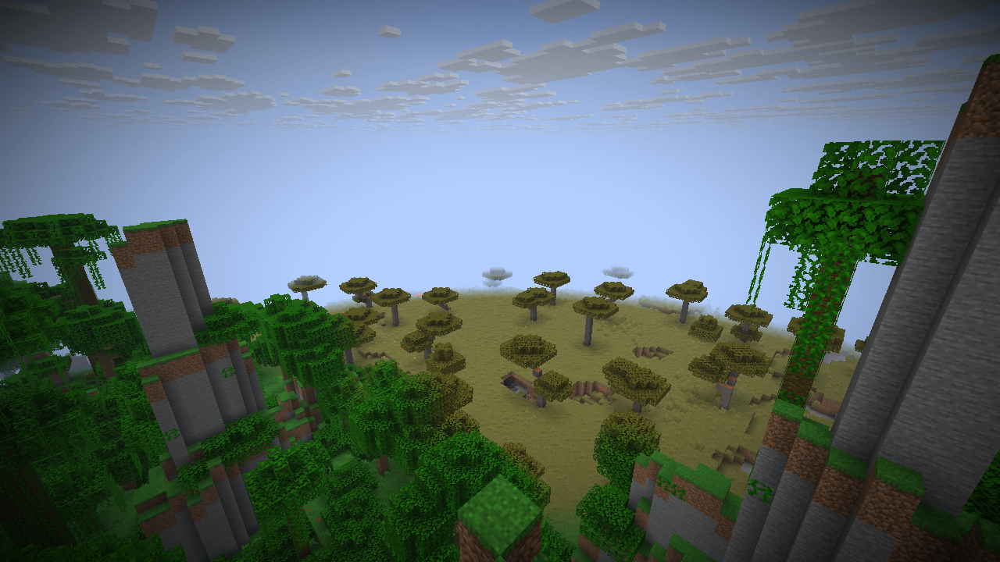
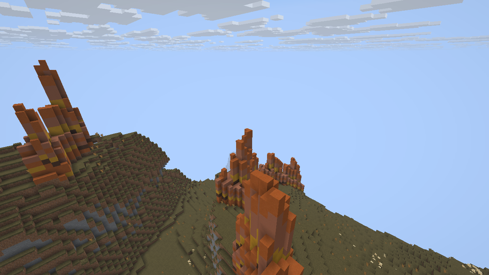

# Native classic-biome runtime integration

This checkpoint installs the previously qualified policy and resource transformer
in the native generation pipeline. It remains an experimental source build.
Standard launcher installation and controlled native performance are separate gates.

The latest native.dev5 [performance and acceptance record](native-carver-performance.md)
qualifies the conditional host carver optimization with a fresh all-17 UI run,
two clean client exits and 56,832 stored biome comparisons. Its 23-image review
includes two lower-camera pillar views from an unchanged copy of that saved
world. Earlier native.dev4 evidence below remains historical, rather than being
silently relabeled for the newer package. General performance, full Java feature
parity and native mod combinations remain open.

The native loader derives 17 biome definitions, three configured features and
eight placed features from the player's existing prepared resources. Native
defaults sit below the complete user pack stack. The merge retains arbitrary
resource kinds and the ordered tag stack, including `replace: true`. Derivation
uses the installed parent biome and feature definitions, rather than embedded
Minecraft JSON. Invalid required references fail loading.

The world owns the biome mapper, feature decoder and seeded pillar sampler.
Marsh material graphs use their original fixed noise seed. Decoder ownership is
retained through lazy feature-catalog reads; it never resides in a static world
cache. The constructor scope used by density decoding still releases its owner
after construction. Resource/client loading guards contain only recursion flags.

Placement translates the host's first-available heightmaps to the source's
highest-taken Y. Pillars use exact noise-biome quarts for eligibility and boundary
taper, fill only air, retain the original unclipped Bryce palette height, and
cap stone using the clipped placement height. Marsh placement uses the unrounded
Minecraft biome-info noise and the independently qualified material selector.

## Observed checks

The [real resource check](../validation/horizon-native-classic-resources-v1.json)
registers all 17 variants with the actual `GeneratorData` loader. It checks user
biome overrides, a replacing inherited tag, retention of a future resource kind,
and a subsequent independent load. It reports no loader warnings.

Two fresh processes pass the [live/stored biome check](../validation/horizon-native-classic-biomes-v1.json).
All 17 variants occur at natural coordinates. Every live source query agrees
with the corresponding stored generated quart. The Java locations are advisory
coordinates; no expected native chunks or terrain snapshots are supplied.
Below-zero cave queries agree with the disabled wrapper, disabling classic
variants returns parent biomes, and both kernel owners release.

Two fresh processes pass [actual native geology placement](../validation/horizon-native-geology-placement-v1.json).
A test pack removes other decoration while retaining the natural biome resolver
and terrain. The real FEATURES region places 892 Bryce blocks in 81 columns,
1,900 stone-forest blocks in 89 columns, and changes 127 marsh blocks in 126
columns. Pillars overwrite zero non-air blocks. Each case reports zero failed
or unsupported features and the kernel releases after the last world owner.
This controlled test does not establish full mixed-decoration or structure parity.

The [pillar geometry checks](../validation/horizon-native-pillar-placement-edges-v2.json)
run the real feature with seeded graphs and a controlled column world. They
exercise clipping, stone caps, boundary tapering, water and structure protection,
invalid footings/biomes, sea and maximum-height limits, foreign seeds, disabled
placement, and propagation of a write failure after two retained writes.
The [first attempt](../validation/horizon-native-pillar-placement-edges-v1.json)
incorrectly assumed a biome's exact advisory block had a positive ridge. The
corrected harness selects a positive column by executing the feature; neither
the kernel nor its height formula is altered to satisfy the test.

The [procedural chunk regression](../validation/horizon-native-classic-runtime-chunks-v2.json)
also agrees across two fresh processes, including distant coordinates, actual
decoration, cold cache regeneration and complete kernel release. Its older
scope text does not claim the separately checked 17-biome corpus.

All checks use existing local resources. Resource hashes remain unchanged and
no game files are downloaded or committed. Reports retain exact probe, engine,
configuration and executable hashes. They are acceptance records for those
specific bytes, not a general Java/Horizon whole-world parity claim.

The [completed UI/save run](../validation/horizon-native-classic-ui-final-v3.json)
uses the exact staged native.dev4 package on host `b33109ad`. It creates the
default preset through the UI, checks a healthy natural survival spawn, renders
all 17 natural classic locations, saves and exits, and reopens in a fresh client
before generating distant terrain. Both clients exit cleanly. Full saved biome
vectors match native generation for 18 chunks after the first save and 19 after
the second: 56,832 stored quart values in total. The seed, native level stem and
structures/bonus-chest flags also match. This is saved-biome and factory
selection acceptance, not independent whole-world Java parity.

Frozen marsh is the first teleport in that run and becomes visible in 30.2
seconds. Some other locations take several minutes; these uncontrolled UI waits
do not establish acceptable native performance. The original high-camera stone
forest image obscures its pillar shafts in fog. The completed
[lower-camera follow-up](../validation/horizon-native-lower-pillars-v1.json)
shows the connected shafts, caps and ground. It plays only an ordinary copy of
the completed QA world; source-world and checked resource hashes stay unchanged.
Both lower views pass agent visual smoke review, with independent Java scenery
parity and player beauty acceptance remaining outside that scope.

These are unmodified screenshots from the lower-camera follow-up:

## Host APIs and remaining work

The integration uses the narrow feature execution and world-owned decoder APIs
in host [PR 8](https://github.com/TheApple05/horizon/pull/8) and
[PR 9](https://github.com/TheApple05/horizon/pull/9). The double-precision helper
and concrete renderer loader return type are in
[PR 10](https://github.com/TheApple05/horizon/pull/10).
The [committed-host precision check](../validation/horizon-host-biome-info-v2.json)
matches 40,898 actual Java observations in debug and release.

For the host change, six renderer biome tests and 581 core/world tests pass;
seven core/world tests are ignored. Formatting, Clippy and public-tree checks
pass. The [fresh Windows suite](../validation/horizon-host-renderer-python-v1.json)
completes all 1,430 listed renderer cases serially: 1,387 pass and 43 retain
their suite-defined ignored status. It uses Vulkan by default, with some GPU
tests explicitly exercising DirectX 12 too. The complete Python suite passes
663 tests with 13 skips after choosing the installed Git Bash only in the
validation child's PATH. The old parallel renderer timeout and failed WSL-stub
run are retained as history. Parallel GPU-test execution and full vanilla
parity are not qualified by the new passes.

Still open: ignored renderer/resource cases and independent whole-feature Java
block parity, mixed features and structures,
source carver configuration, standard launcher installation, scenery review,
controlled native performance and native mod combinations.
