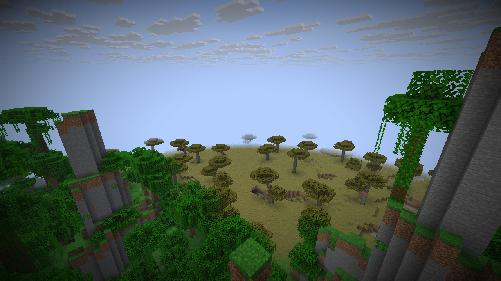
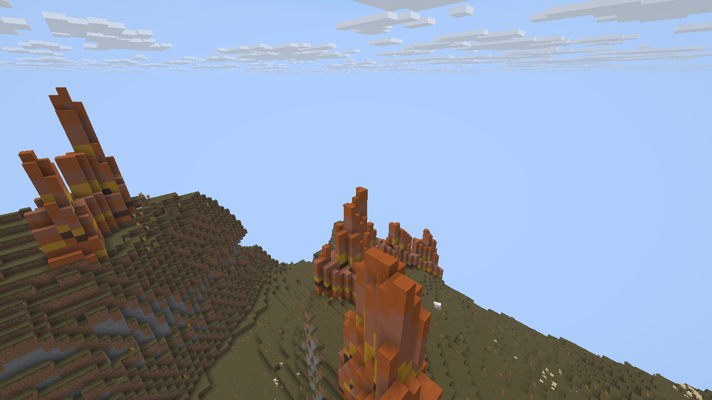

# Native carver selection performance

The native.dev5 update pins host `1860b66439c6c0c07afd1a13252c1cf9405fb38e`.
It removes repeated biome queries only when all possible biomes share the same
ordered carver holders. Final resource overrides and mapped biome possibilities
are checked before enabling that path. Mixed, unresolved, differently ordered
and independently decoded inline sets retain ordinary lookup. Carver algorithms, random calls,
origin order and the native tile-cache capacity of eight remain unchanged.

The qualified native.dev4 host and this candidate differ in production code only
in `horizon-world/src/worldgen/generator.rs`; the other host difference is documentation.
The host change is tracked in [PR 12](https://github.com/TheApple05/horizon/pull/12)
and [native issue 4](https://github.com/TheApple05/TerraForged-Horizon/issues/4).

## Measurements and output checks

The existing optimized chunk-generation example was given QA-only world-stem
selection. It generated a five-by-five batch centered at chunk `(-7936, 4753)`,
seed `8675309`, four workers, structures enabled and decoration disabled. This
is the cold-steppe location that previously took 300.3 seconds to become visible
in the full client. Proto generation and full-client visibility are different
measurements.

Three alternating fresh-process runs per implementation produced:

- Baseline: 6.596, 5.429 and 5.982 seconds of proto generation.
- Uniform selection: 1.826, 1.848 and 1.929 seconds.
- Median: 5.982 to 1.848 seconds, or 69.1% shorter for this batch.
- Accumulated carver worker time per chunk: median 751.429 to 0.665 ms.

Every run exits zero and produces the same 21,964,738-byte ordered snapshot,
SHA-256 `bb6a44a89bd28672eab03f9a05c4f50b710b92ff3e6b4dce3a99dda46b76e39f`.
The snapshot includes full section states, public block reads, biome quarts,
heightmaps, postprocessing/ticks, structure metadata and entity NBT. Snapshot
serialization is outside the measured generation interval. A separate host
regression compares every block and biome with forced ordinary lookup, and
resource-override tests check that differing lists disable the shortcut.

The [unaltered recheck receipt](../validation/horizon-native-uniform-carvers-recheck-v1.json)
retains commands, executable/log hashes, all six timings and output hashes.
Independent review checked its log values and snapshots. The staged world
library also passes strict Clippy with warnings denied.

Other-project compilation was active on this machine, so these are diagnostic
measurements with possible CPU contention. The example's Windows `cpu_s: 0`
means unavailable measurement, not zero CPU use. These results do not establish
full decoration, distant streaming, frame rate, other seeds, memory behavior,
parallel scaling or modpack performance acceptance.

## Retained failure and current qualification

The [first attempt](../validation/horizon-native-uniform-carvers-first-attempt-v1.json)
passed two output comparisons, then Windows denied an atomic report-file
replacement. The harness terminated its third child and preserved that failed
receipt. The precise file-lock holder was not traced. The follow-up adds bounded
retry handling to QA report replacement and completes all six alternating runs.
There is no generator failure recorded in that interrupted attempt.

The [native.dev5 package receipt](../validation/horizon-native-dev5-package-v1.json)
records its exact source bundle and SHA-256. Host protected CI passes on host
`1860b664`. All five native integration modes and Windows/Linux foundations pass
on the first published candidate, `8e1a689`. Fresh CI on verifier head `b3ef5b7`
also passes [all five integration modes](https://github.com/TheApple05/TerraForged-Horizon/actions/runs/42431935808)
and [both foundations](https://github.com/TheApple05/TerraForged-Horizon/actions/runs/42431935828).

The [first fresh-stage UI attempt](../validation/horizon-native-classic-ui-uniform-v1.json)
stopped before compilation or game launch because the save probe was absent.
The UI verifier had depended on an earlier client verifier preparing that file.
Both tools now share the existing checked setup, with a regression covering a
fresh stage, repeated setup and conflicting probe/target rejection. The UI CI
mode runs that check.

The [second attempt](../validation/horizon-native-classic-ui-uniform-v2.json)
renders ten variants, including cold steppe in 30.843 seconds and frozen marsh
in 30.265 seconds, then the client exits during shattered savanna after 3.094
seconds. There is no completed candidate save check in that run. Its final game
log contains no panic or normal shutdown trail; targeted Windows Application and
System event queries succeeded and found no matching application-crash or display
driver events in the surrounding four-minute window. The old verifier did not
retain the process exit code, preventing a firm diagnosis. Reviewed CLI,
event-loop and supervisor paths provide no self-timeout explanation; this does
not establish the actual cause or prove external termination.

The verifier now records client commands, PIDs and the process exit code on error.
A fresh [isolated shattered-savanna run](../validation/horizon-native-classic-ui-shattered-v1.json)
renders that target in 8.109 seconds. Both real clients exit zero, actual saved
biome checks pass after creation and reopening/distant generation, and checked
resources stay unchanged. That is selected-target recovery evidence, not an
all-17 acceptance claim. The earlier exit remains unexplained and is not labeled
as a fixed runtime bug.

## Completed fresh client/save and visual acceptance

The [fresh all-17 run](../validation/horizon-native-classic-ui-uniform-v3.json)
starts with shattered savanna and completes with the stronger diagnostics.
Every natural target renders and both actual clients exit zero. Saved FULL
chunks contain 27,648 checked biome values in 18 chunks after the first save and
29,184 values in 19 chunks after reopening and generating distant terrain:
56,832 total. Every stored fingerprint matches native generation and differs
from its vanilla reference. Native stem, seed and generation flags remain
correct; checked original and copied resources remain unchanged. The initial
survival spawn is healthy and grounded before QA spectator/daylight controls.

The [lower-camera follow-up](../validation/horizon-native-lower-pillars-uniform-v1.json)
opens an ordinary copy of the completed saved world and exits zero. The source
world, resources and pinned artifacts remain unchanged. Its two views resolve
the original high-camera pillar ambiguity. The separate [23-image review](../validation/horizon-native-dev5-image-review-v1.json)
checks every actual PNG hash and records visible rendering acceptance, while
retaining fog/cutoff/chat-overlay limits and excluding full Java geometry parity
and user aesthetic approval. [Daylight controls](../validation/horizon-native-dev5-daylight-controls-v1.json)
are retained separately from the immutable raw reports.

These [unmodified previews](../validation/horizon-native-dev5-preview-v1.json)
come from that exact native.dev5 follow-up:

Fir forest also remains slow: its candidate full-ready check takes 180.156
seconds in the interrupted sequence and 184.172 seconds in the completed repeat,
versus 224.203 seconds in the earlier native.dev4 sequence. Cold steppe takes
111.406 seconds in the completed sequence, versus 30.843 seconds when tested
first in the interrupted sequence. These are uncontrolled full-ready waits with
different request order and other compilation active; they are not FPS or
throughput measurements. In-flight generation and resident proto counts also
do not establish throughput.

## Focused fir-forest follow-up

At the exact fir chunk `(0, -2731)`, seed `8675309`, with structures and real
decoration enabled, the [small four-worker diagnostic](../validation/horizon-native-fir-profile-v1.json)
generates 25 protos in 2.942 seconds and decorates nine interiors in 0.0223 seconds.
The larger footprint separates generation from decoration:

- [Four workers](../validation/horizon-native-fir-halo4-v1.json): 361 protos in
  12.571 seconds; 289 decorated interiors in 0.1936 seconds.
- [Fifteen workers](../validation/horizon-native-fir-halo15-v1.json): 361 protos in
  7.789 seconds; 289 decorated interiors in 0.1070 seconds.

Both larger runs place 18,300 feature roots with zero failed or unsupported
roots, and produce byte-identical complete terrain and decorated snapshots.
The retained console outputs for [four workers](../validation/horizon-native-fir-halo4-v1.stdout.txt)
and [fifteen workers](../validation/horizon-native-fir-halo15-v1.stdout.txt)
contain the placement counts and structure summaries. Actual executable, log
and snapshot hashes were independently checked. Snapshots remain local and are
not distributed with the port.

Each configuration has one observation and another Horizon client was active.
These batches do not reproduce the long live-client wait, do not include live
scheduling, lighting, meshing or uploads, and do not justify changing worker
count or cache capacity. The remaining delay requires profiling those live
stages. Windows `cpu_s: 0` remains an unavailable measurement.

The broader limits in the [reviewed issues report](issues-2026-11-07.md) remain:
source carver settings, independent full Java feature parity, launcher
installation and native mod combinations are unfinished.
